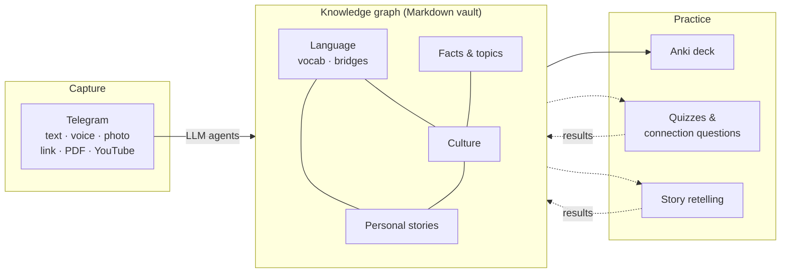
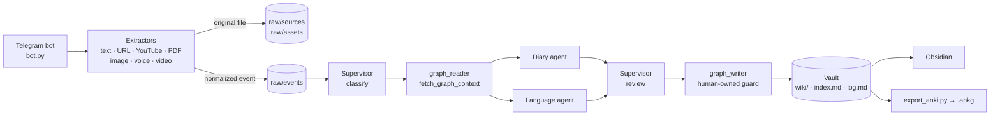

# llm-personal-knowledge-os

**A personal learning engine. What you experience, read and hear becomes connected knowledge, and that knowledge becomes practice.**

You send a Telegram bot whatever crosses your day: a diary line, a voice note, a link, a photo, a YouTube video. LLM agents compile it into a typed, cross-linked knowledge graph of plain Markdown pages. From that graph the system builds learning material that is about *your* life and *your* interests, not a generic deck: vocabulary cards, connections between languages, cultural background, and stories worth retelling.

> **Status:** working single-user prototype. Capture → knowledge graph → Anki export runs end to end and is covered by tests. The practice layer (quizzes, spaced repetition, story retelling) is the focus of the [roadmap](ROADMAP.md).

---

## Why

Most learning tools sit at one of two extremes:

- **Flashcard apps** drill isolated facts from decks someone else wrote. The facts have no connection to each other or to your life, so they fade.
- **Note-taking and "second brain" apps** store everything and never ask you a single question.

Memory works through **personal relevance** and **connections**. A Spanish word you needed yesterday sticks better than one from a list. It sticks even better when you also know why it sounds like its English cousin, and you have a story of the moment you needed it.

This project closes that gap. The knowledge graph is not the product; it is the substrate. The product is a learning loop built on top of it.

## How it works



*Solid lines exist today; dotted lines are on the roadmap.*

1. **Capture without friction.** Everything you send is normalized to text (local Whisper transcription, Claude Vision for images, transcripts for YouTube) and stored as an immutable raw event.
2. **Compile into a knowledge graph.** A LangGraph supervisor routes each input to domain agents. Before writing, they retrieve what the graph already knows, so every new page is linked into existing knowledge instead of being filed in isolation. This follows Andrej Karpathy's "LLM Wiki" idea: the LLM maintains the wiki, and you read and correct it.
3. **Turn knowledge into practice.** Pages carry what exercises need: translations, example sentences, mnemonics, cross-language insights, narrative hooks. Today this becomes an Anki deck. Next, it becomes quizzes, connection questions and retelling prompts in Telegram, scheduled by spaced repetition.
4. **Close the loop** *(roadmap)*. Practice results flow back into the graph as mastery per page, so the system knows what you know and what to ask next.

## One message, many connections

An example from the fictional demo vault in [`sample_vault/`](sample_vault/). "Alex" is learning Spanish, has just bought a paella pan, and sends the bot one line:

> *"First paella in the new pan. Waited for the crackling sound everyone talks about — what came was the smoke alarm. Burnt the socarrat completely."*

The agents turn this into linked pages across domains:

| Page | Domain | What it holds |
|---|---|---|
| [`pf_2026-03-22_first-burnt-socarrat`](sample_vault/wiki/personal/facts/pf_2026-03-22_first-burnt-socarrat.md) | Personal story | The experience, a `story_score` (how retellable it is), a narrative hook, links to the earlier and later facts in the same story arc |
| [`v_es_socarrat`](sample_vault/wiki/language/vocab/v_es_socarrat.md) | Language | Translations, grammar, example sentences, mnemonic, CEFR level |
| [`c_es_paella-valenciana`](sample_vault/wiki/language/culture/c_es_paella-valenciana.md) | Culture | Where the dish comes from and how it is made and eaten |
| [`lb_es-en_azafran`](sample_vault/wiki/language/bridges/lb_es-en_azafran.md) | Language bridge | *azafrán* ↔ *saffron*: same Arabic root, which is why so many Spanish food words start with *a-* |

From the same pages, the learning layer produces different kinds of practice:

| Exercise | Example | Status |
|---|---|---|
| Vocabulary card | *el socarrat* → crispy toasted rice layer + example + mnemonic | ✅ Anki export |
| Connection question | "Why do *azafrán*, *azúcar* and *arroz* all start with *a-*?" | 🛠 Roadmap |
| Cloze from your own life | "La primera vez se me quemó el ___ y sonó la alarma." | 🛠 Roadmap |
| Story retelling | "Tell the smoke-alarm story in Spanish in under a minute. Use *socarrat* and *sartén*." Voice answer, transcribed, with feedback | 🛠 Roadmap (schema ready: `story-ready` status, `practice_log`) |

## Domains

Knowledge is organized in domains. Each domain brings its own page types and, in the learning layer, its own exercise generators. The domain model is designed to be extended.

| Domain | Page types | Status |
|---|---|---|
| **Language** | VocabEntry, LanguageBridge (cognate, false friend, concept gap, structural parallel) | ✅ Built (German/English → Spanish) |
| **Culture** | CulturalEntry | ✅ Built |
| **Personal stories** | PersonalFact with `story_score`, correlations, elaboration, social context | ✅ Built; retelling practice on the roadmap |
| **Facts & topics** (science, history, …) | TopicPage with sourced claims | 🛠 Source inventory built; claim extraction on the roadmap |
| **Your own domain** | Plugin interface: page types + agent + exercise generators | 🛠 Roadmap |

## What works today

- **Telegram capture** of text, voice messages, photos, documents (PDF, `.md`, `.txt`), videos and video notes, web URLs and YouTube links. Voice and video are transcribed locally with `faster-whisper`; photos are described or OCR'd with Claude Vision. Bare links and uncaptioned images are quick-saved for later.
- **LangGraph supervisor pipeline:** `classify → fetch_graph_context → diary_agent | language_agent (in parallel when both apply) → supervisor_review → write_to_graph → update_index`.
- **Diary agent:** extracts PersonalFacts, scores how story-worthy they are, finds correlations with earlier facts, and elaborates the strong ones into retellable stories.
- **Language agent:** detects target-language words and creates VocabEntries (translations, examples, mnemonics), LanguageBridges and CulturalEntries.
- **Graph-aware writing:** retrieval over `index.md`, with SQLite FTS5 for larger vaults when the index database exists.
- **Anki export:** `scripts/export_anki.py` builds an `.apkg` deck from elaborated VocabEntries, with stable note IDs so re-exports update cards instead of duplicating them.
- **Lint agent:** structural checks (orphan pages, missing backlinks, vocab without cards). Built as a module; scheduling is on the roadmap.
- **Human-owned zones:** folders the AI may read but never write, enforced in `graph_writer` before every write.
- **Bootstrap interview:** `/bootstrap` asks ten questions to seed the graph.
- **Model setup:** Claude Haiku 4.5 for cheap classification and Claude Sonnet 4.6 for synthesis. Without an API key, everything runs against a local Ollama model.
- **Tests:** 52 pytest tests covering index rendering, migrations, multimodal extraction, ingest, the write guard and configuration.

## Design principles

- **Personal relevance first.** Exercises come from your own experiences and interests, not from a stock deck.
- **Connections over isolated facts.** Every page is written with the existing graph as context; bridges between languages, culture and stories are first-class pages.
- **Your data stays yours.** The graph is plain Markdown with YAML frontmatter in a folder you own. Open it in Obsidian, version it with git, read it without this software. Local-only operation is possible via Ollama.
- **The LLM proposes, you own.** Raw input is immutable, agents write only through a reviewed path, and human-owned zones are off-limits to the AI.

## Architecture



Agents never write files directly. They return `WikiWrite` objects in the LangGraph state, and only `graph_writer` executes them after the supervisor's review. The Markdown vault is the only persistent state.

| Path | Contents |
|---|---|
| `bot.py` | Telegram bot: handlers for every input type, `/bootstrap` interview |
| `main_workflow.py` | LangGraph main graph and the `run_ingest()` entry point |
| `agents/` | Supervisor, diary, language and lint agents, `graph_reader`, `graph_writer`, `config.py` |
| `agents/extractors/` | Per-format extraction (URL, YouTube, PDF, image, audio/video) |
| `scripts/` | `init_wiki.py`, `rebuild_index.py`, `export_anki.py`, `ingest_clippings.py`, `test_ingest.py`, data `migrations/` |
| `sample_vault/` | Fictional demo vault, the default data root |
| `tests/` | pytest suite |
| `doc/` | [Architecture](doc/ARCHITECTURE.md) and [schema](doc/SCHEMA.md) in English; German originals in `doc/de/`, German component specs and decision log in `doc/` |

## Tech stack

Python · [LangGraph](https://github.com/langchain-ai/langgraph) · [Anthropic Python SDK](https://github.com/anthropics/anthropic-sdk-python) (Claude Haiku 4.5 / Sonnet 4.6, Claude Vision) · Ollama (optional local fallback) · [python-telegram-bot](https://github.com/python-telegram-bot/python-telegram-bot) · [faster-whisper](https://github.com/SYSTRAN/faster-whisper) · youtube-transcript-api · requests + BeautifulSoup · pdfplumber · langdetect · genanki · PyYAML · SQLite FTS5 · Obsidian-flavoured Markdown · pytest

## Setup

Requirements: **Python 3.10+** (developed on 3.14), **ffmpeg** on your `PATH` (for voice and video), and a Telegram bot token from [@BotFather](https://t.me/BotFather).

```bash
git clone https://github.com/ChrisKre/llm-personal-knowledge-os.git
cd llm-personal-knowledge-os

python -m venv .venv
# Windows: .venv\Scripts\activate    macOS/Linux: source .venv/bin/activate
pip install -r requirements.txt

# ffmpeg, e.g.:  winget install ffmpeg  |  brew install ffmpeg  |  apt install ffmpeg

cp .env.example .env    # then fill in the values
```

| `.env` key | Required | Purpose |
|---|---|---|
| `TELEGRAM_BOT_TOKEN` | yes | Bot token from @BotFather |
| `TELEGRAM_ALLOWED_USER_ID` | recommended | Your numeric Telegram user ID. Empty = discovery mode: the bot logs incoming user IDs so you can copy yours |
| `ANTHROPIC_API_KEY` | optional | Claude API key. Without it, the local Ollama fallback is used |
| `OLLAMA_HOST`, `OLLAMA_MODEL` | optional | Ollama endpoint and model (defaults: `http://localhost:11434`, `llama3.2`) |
| `KOS_VAULT_ROOT` | optional | Absolute path to your own vault. Unset = `sample_vault/` |

To start your own private vault outside the repo:

```bash
# in .env:  KOS_VAULT_ROOT=/path/to/knowledge-vault
python scripts/init_wiki.py                 # creates wiki/, raw/, index.md, log.md, user_profile.md
cd /path/to/knowledge-vault && git init     # optional, recommended
```

## Usage

```bash
python bot.py                                   # start the Telegram bot (long polling)
python scripts/test_ingest.py "Today I learned the word 'sobremesa'."   # run the pipeline without Telegram (dry run)
python scripts/test_ingest.py "..." --write     # ...and actually write the pages
python scripts/rebuild_index.py                 # rebuild index.md from the vault's frontmatter
python scripts/export_anki.py                   # export elaborated VocabEntries to an Anki deck
python -m pytest                                # run the test suite
```

Open the vault folder (`sample_vault/` or your `KOS_VAULT_ROOT`) in Obsidian to explore the graph.

> **Language note:** the bot's replies and several prompts are currently in German, and the language agent is tuned for German → Spanish. English UI strings and a configurable language pair are on the [roadmap](ROADMAP.md).

## Data and privacy

- **The repository contains no personal data.** `sample_vault/` is entirely fictional.
- **Real data lives in a separate private vault**, selected with `KOS_VAULT_ROOT`. `wiki/`, `raw/`, `index.md`, `log.md`, `user_profile.md`, `*.db` and `.env` at the repo root are gitignored.
- The test suite is pinned to `sample_vault/` (see `tests/conftest.py`) and never touches a real vault.
- With `ANTHROPIC_API_KEY` set, your input is sent to the Claude API for processing. Without it, all LLM calls stay on your machine via Ollama. Voice transcription always runs locally.

## Roadmap

The next milestones build the practice layer: an exercise model, Telegram quizzes with spaced repetition, story retelling with voice answers, a cross-domain connection finder, and a plugin interface for new domains. See [ROADMAP.md](ROADMAP.md) and the GitHub issues.

## Development logs

The project was built in documented sessions. **The development logs are in German:** `sessions/`, `workshop/`, `hinweise/`, `sessions_ux/`, `sessions_gedankenexperiment/`, `prompts_team/`, and in `doc/` the decision log `ENTSCHEIDUNGEN.md` plus the component specs. Personal details have been removed for this public release.

## License

[MIT](LICENSE) © 2026 Christopher Kremkow
