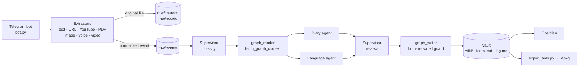

# llm-personal-knowledge-os

**An LLM-maintained personal knowledge wiki.** You send the bot everyday input on Telegram: a diary line, a voice note, a link, a photo, a PDF or a YouTube video. LLM agents turn it into typed, cross-linked Markdown pages in a vault you can browse with Obsidian.

## What it does

The project builds on Andrej Karpathy's "LLM Wiki" idea. You don't search a pile of raw notes at question time. An LLM *compiles* raw input once into a structured wiki and keeps it up to date. Raw input is immutable. The wiki pages are written by the agents, and you read and correct them.

In practice:

- **Capture without friction.** Anything you send to the Telegram bot is normalized to text and stored as a raw event in the vault.
- **Classify and route.** A supervisor decides whether the input is a personal experience, a language item, or both, and sends it to the matching agent.
- **Use what the wiki already knows.** Before an agent writes, the relevant existing pages are retrieved as context ("graph context"). A new entry is therefore judged and linked against your existing knowledge, not in isolation.
- **Write typed pages.** The agents produce Markdown pages with YAML frontmatter (PersonalFact, VocabEntry, CulturalEntry, LanguageBridge, …) plus an `index.md` and an append-only `log.md`.
- **Reuse the knowledge.** Vocabulary entries can be exported as an Anki deck. The vault is plain Markdown, so Obsidian's graph view, backlinks and search work out of the box.

## Features

- **Telegram capture:** text, voice messages, photos, documents (PDF, `.md`, `.txt`), videos and video notes, web URLs and YouTube links.
  - Voice and video audio are transcribed locally with `faster-whisper`.
  - Photos are described or OCR'd with Claude Vision.
  - Web pages are fetched with `requests` + BeautifulSoup; YouTube transcripts come from `youtube-transcript-api` (no download, no API key).
  - Bare URLs and images without a caption are quick-saved; with a caption ("hint") they are processed right away.
- **LangGraph supervisor pipeline:** `classify → fetch_graph_context → diary_agent | language_agent (or both in parallel) → supervisor_review → write_to_graph → update_index`.
- **Diary agent:** extracts PersonalFacts, scores how story-worthy they are (`story_score` 0–10), finds correlations with earlier facts, and elaborates high-scoring ones.
- **Language agent:** detects target-language words and creates VocabEntries (translations, example sentences, mnemonics), LanguageBridges (cognates, false friends, concept gaps) and CulturalEntries.
- **Lint agent:** structural health checks for the wiki (orphan pages, stale raw facts, missing backlinks, vocab without Anki cards). It exists as a module but isn't scheduled or wired into the pipeline yet; see the [roadmap](ROADMAP.md).
- **Retrieval:** keyword search over `index.md` for small wikis (< 30 pages); above that, SQLite FTS5 is used if `wiki_index.db` exists, with automatic fallback to `index.md`.
- **Human-owned zones:** directories the AI may read but never write (default: `wiki/personal/health/`). This is enforced by a guard in `graph_writer` before every write.
- **Anki export:** `scripts/export_anki.py` builds an `.apkg` deck from elaborated VocabEntries with `genanki`, with stable note IDs persisted in frontmatter.
- **Bootstrap interview:** `/bootstrap` in Telegram asks ten questions to seed the wiki with first personal facts.
- **Provider fallback:** with `ANTHROPIC_API_KEY` set, the agents use Claude Haiku 4.5 (cheap classification) and Claude Sonnet 4.6 (synthesis). Without a key, everything runs against a local Ollama model, which is useful for testing the mechanics offline.
- **Single-user access:** the bot answers only the Telegram user ID in `TELEGRAM_ALLOWED_USER_ID`.

## Who it's for

People who want a personal knowledge base that maintains itself from what they send it, especially **language learners**. The default setup assumes German as the primary language and Spanish as the target language, and connects vocabulary to your own experiences and to cultural context. It is a single-user, self-hosted tool, not a hosted service.

> **Language note:** the bot's replies, the bootstrap questions and several LLM prompts are currently in German, and the language agent is tuned for German → Spanish. Translating the user-facing strings and making the language pair configurable is on the [roadmap](ROADMAP.md).

## Architecture



Agents never write files directly. They return `WikiWrite` objects in the LangGraph state, and only `graph_writer` executes them after the supervisor's review. The Markdown vault is the only persistent state. The LangGraph state lives for one run.

### Folder map

| Path | Contents |
|---|---|
| `bot.py` | Telegram bot: handlers for every input type, `/bootstrap` interview |
| `main_workflow.py` | LangGraph main graph and the `run_ingest()` entry point |
| `agents/` | Supervisor, diary, language and lint agents, `graph_reader`, `graph_writer`, frontmatter helper, `config.py` |
| `agents/extractors/` | Format detection and per-format extraction (URL, YouTube, PDF, image, audio/video) |
| `scripts/` | CLI tools: `init_wiki.py`, `rebuild_index.py`, `export_anki.py`, `ingest_clippings.py`, `test_ingest.py`, `test_voice.py`, versioned data `migrations/` |
| `sample_vault/` | Fictional demo vault: the default data root |
| `tests/` | pytest suite (lint/index, migrations, render, multimodal, ingest, graph_writer, config) |
| `doc/` | Architecture, schema and component specs; German originals in `doc/de/` |
| `sessions/`, `workshop/`, `hinweise/`, `sessions_*/`, `prompts_team/` | Development logs and planning documents (German) |

More detail: [doc/ARCHITECTURE.md](doc/ARCHITECTURE.md) (pipeline, supervisor, agents) and [doc/SCHEMA.md](doc/SCHEMA.md) (vault layout, page types, naming and frontmatter rules).

## Tech stack

Python · [LangGraph](https://github.com/langchain-ai/langgraph) · [Anthropic Python SDK](https://github.com/anthropics/anthropic-sdk-python) (Claude Haiku 4.5 / Sonnet 4.6, Claude Vision) · Ollama (optional local fallback) · [python-telegram-bot](https://github.com/python-telegram-bot/python-telegram-bot) · [faster-whisper](https://github.com/SYSTRAN/faster-whisper) · youtube-transcript-api · requests + BeautifulSoup · pdfplumber · langdetect · genanki · PyYAML · SQLite FTS5 · Obsidian-flavoured Markdown · pytest

## Setup

Requirements: **Python 3.10+** (developed on 3.14), **ffmpeg** on your `PATH` (for voice and video), and a Telegram bot token from [@BotFather](https://t.me/BotFather).

```bash
git clone https://github.com/<your-user>/llm-personal-knowledge-os.git
cd llm-personal-knowledge-os

python -m venv .venv
# Windows: .venv\Scripts\activate    macOS/Linux: source .venv/bin/activate
pip install -r requirements.txt

# ffmpeg, e.g.:  winget install ffmpeg  |  brew install ffmpeg  |  apt install ffmpeg

cp .env.example .env    # then fill in the values
```

`.env` keys (see [.env.example](.env.example) for details):

| Key | Required | Purpose |
|---|---|---|
| `TELEGRAM_BOT_TOKEN` | yes | Bot token from @BotFather |
| `TELEGRAM_ALLOWED_USER_ID` | recommended | Your numeric Telegram user ID. Empty = discovery mode: the bot logs incoming user IDs so you can copy yours |
| `ANTHROPIC_API_KEY` | optional | Claude API key. Without it, the local Ollama fallback is used |
| `OLLAMA_HOST`, `OLLAMA_MODEL` | optional | Ollama endpoint and model (defaults: `http://localhost:11434`, `llama3.2`) |
| `KOS_VAULT_ROOT` | optional | Absolute path to your own vault. Unset = `sample_vault/` |

### Your own vault

To start a fresh private vault outside the repo:

```bash
# in .env:  KOS_VAULT_ROOT=/path/to/knowledge-vault
python scripts/init_wiki.py        # creates wiki/, raw/, index.md, log.md, user_profile.md
cd /path/to/knowledge-vault && git init   # optional, recommended: version your vault
```

## Usage

```bash
python bot.py                                   # start the Telegram bot (long polling)
python scripts/test_ingest.py "Today I learned the word 'sobremesa'."   # run the pipeline without Telegram (dry run)
python scripts/test_ingest.py "..." --write     # ...and actually write the pages
python scripts/rebuild_index.py                 # rebuild index.md from the vault's frontmatter
python scripts/export_anki.py                   # export elaborated VocabEntries to out/*.apkg
python -m pytest                                # run the test suite
```

Open the vault folder (`sample_vault/` or your `KOS_VAULT_ROOT`) in Obsidian to browse the result.

## Data and privacy

- **The repository contains no personal data.** `sample_vault/` is a fictional demo vault: "Alex", who is learning to cook paella, with a few PersonalFacts, Spanish VocabEntries, one CulturalEntry and one LanguageBridge.
- **Real data belongs in a separate private vault**, selected with `KOS_VAULT_ROOT`. `wiki/`, `raw/`, `index.md`, `log.md`, `user_profile.md`, `*.db` and `.env` at the repo root are gitignored.
- The test suite is pinned to `sample_vault/` (see `tests/conftest.py`) and never touches your real vault.
- With `ANTHROPIC_API_KEY` set, your input is sent to the Claude API for processing. Without it, all LLM calls stay on your machine via Ollama. Voice transcription always runs locally.

## Project status

Working single-user prototype. The capture → classify → agent → write → index loop runs end to end against a real vault, and the test suite passes. Several designed parts are not wired up yet: scheduled lint runs, the draft → approve branch workflow, building the SQLite FTS5 index, and batch ingestion of web clippings beyond the inventory stage. See [ROADMAP.md](ROADMAP.md).

## Roadmap

See [ROADMAP.md](ROADMAP.md) and the GitHub issues.

## Development logs

The project was developed in documented sessions. **The development logs are in German:** `sessions/`, `workshop/`, `hinweise/`, `sessions_ux/`, `sessions_gedankenexperiment/`, `prompts_team/`, and in `doc/` the decision log `ENTSCHEIDUNGEN.md` plus the component specs (`COMP_*.md`, `KNOWLEDGE_GRAPH.md`, `CHANCEN.md`, …). Personal details have been removed from them for this public release.

## License

[MIT](LICENSE) © 2026 Christopher Kremkow
